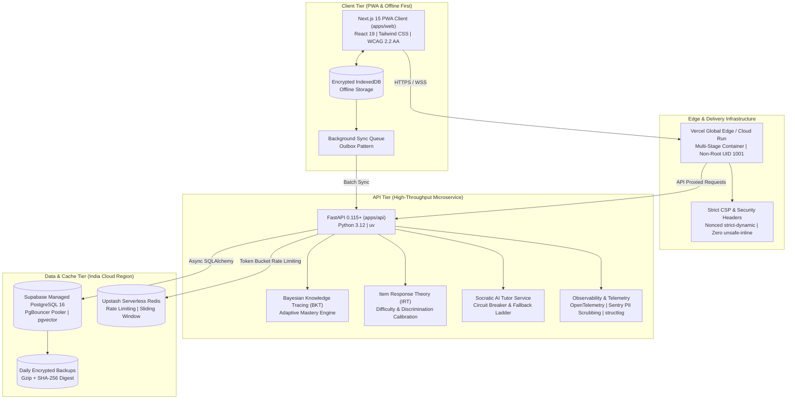

# BodhAI (बोधAI)

> **Adaptive Mastery Learning Platform for Middle & Secondary School (Classes 6–10) in India.**  
> Aligned with NCERT, CBSE, and the National Education Policy (NEP 2020) Pedagogical Framework.

---

## Architecture Overview



---

## Production & Pilot Readiness Highlights

### 1. Deploy & Infrastructure

- **Multi-Stage Dockerfiles**: Minimal, secure, non-root containers (`nextjs:nodejs` UID 1001 on Alpine Node 22; `appuser:appgroup` UID 1001 on Python 3.12 slim). Integrated container health check probes.
- **Environment Parity**: Dedicated environment templates (`.env.development`, `.env.staging`, `.env.production`) with strict fail-fast validation for secrets, CORS, and connection strings.
- **CI/CD Pipelines**: GitHub Actions workflow running PR verification (`pnpm verify`), cross-browser E2E (Chromium, Firefox, WebKit), Gitleaks secret scanning, dependency audits (`pnpm audit`, `pip-audit`), Semgrep SAST, and automated staging/production delivery (`cd.yml`).
- **Zero-Downtime Migrations**: Expand-Contract schema migration strategy with rollback runbooks (`docs/migrations/MIGRATION_STRATEGY.md`).
- **Hosting Targets ADR**: Architectural Decision Record (`docs/ADR/0002-production-infrastructure-targets.md`) detailing Vercel for Web, Cloud Run for API, Supabase for Postgres (pgvector), and Upstash for Redis.
- **Terraform IaC**: Production blueprints in `infra/terraform/` for Cloud Run container hosting, Secret Manager secrets, and IAM service accounts.

### 2. Observability & Telemetry

- **Sentry Integration**: Dual client (`apps/web/src/lib/sentry.ts`) and server (`apps/api/app/core/telemetry.py`) error and performance tracking with strict DPDP-compliant PII scrubbing (redacting emails, Indian phone numbers, Bearer tokens).
- **OpenTelemetry & Structured Logging**: `structlog` emitting standardized JSON in production; in-memory metrics registry tracking request counts, error rates, p50/p95/p99 latency, offline sync failures, and LLM token usage.
- **SLOs & Dashboards**: Specifications defined in `docs/observability/DASHBOARDS.md`:
  - **Availability Target**: **99.5%** monthly uptime.
  - **Latency Target**: **p95 < 300 ms** across core learning interaction endpoints.
  - Alert rules for error spikes ($> 1\%$), p95 latency breaches, and sync queue backlog.

### 3. Operations & Disaster Recovery

- **Automated Backup & Restore Drill**: Standalone scripts (`scripts/backup_db.py`, `scripts/restore_db.py`) executing gzip compression with SHA-256 verification. Tested and documented in `docs/runbooks/RESTORE_DRILL.md`.
- **Feature Flags Engine**: Typed flags (`aiTutor`, `offlineMode`, `demoMode`, `detailedDiagnostics`, `feedbackForm`) allowing zero-downtime feature gating.
- **Accessible Maintenance Mode**: Dedicated bilingual maintenance page (`apps/web/src/app/[locale]/maintenance/page.tsx`) with middleware redirect and bypass header.
- **Comprehensive Runbooks**: In `docs/runbooks/`:
  - [`INCIDENT_RESPONSE.md`](docs/runbooks/INCIDENT_RESPONSE.md): Severity matrix, Incident Commander workflows, and bilingual school notification templates.
  - [`ROLLBACK.md`](docs/runbooks/ROLLBACK.md): Step-by-step rolling back of containers and migrations.
  - [`KEY_ROTATION.md`](docs/runbooks/KEY_ROTATION.md): Rotating JWT keys, database roles, and OpenAI tokens without downtime.
  - [`LLM_OUTAGE.md`](docs/runbooks/LLM_OUTAGE.md): Circuit breaker trip handling and deterministic Socratic hint fallbacks.
- **Semantic Versioning**: Standardized `CHANGELOG.md` following Keep a Changelog.

### 4. Pilot Readiness & Classroom Tools

- **Privacy-Preserving Analytics**: Client-side event tracker (`apps/web/src/lib/analytics.ts`) with zero student PII, ephemeral session hashing, and DPDP Act 2023 compliance.
- **Model Evaluation Dashboard**: Evaluation engine (`apps/api/app/engine/evaluation.py` and `/admin/evaluation` UI) computing ROC-AUC and Expected Calibration Error (ECE) of next-response predictions over real attempts using student-level holdout splits to prevent data leakage.
- **In-App Feedback Modal**: Accessible, bilingual pilot feedback dialog (`apps/web/src/components/feedback-modal.tsx`) capturing classroom feedback.
- **Judge & Evaluator Demo Mode**: Synthetic classroom data generator (`apps/web/src/lib/demo-data.ts`) enabling instant demonstration of analytics, heatmaps, and knowledge states without manual setup.
- **Teacher Quick-Start Guides**: Pragmatic 5-minute onboarding guides in [English](docs/guides/TEACHER_QUICKSTART_EN.md) and [Hindi](docs/guides/TEACHER_QUICKSTART_HI.md).

---

## Quickstart & Local Development

### Prerequisites

- Node.js `v22+` / `v24+` (managed via `.nvmrc`)
- `pnpm` `v10+`
- Python `3.12+` & `uv`

### Installation & Verification

```bash
# 1. Install Node dependencies
pnpm install

# 2. Setup Python virtual environment
cd apps/api && uv sync --all-groups && cd ../..

# 3. Run full verification gate (Lint, Typecheck, Test, Build)
pnpm verify
```

### Running Locally

```bash
# Start Turborepo dev servers (Web on :3000, API on :8000)
pnpm dev
```
