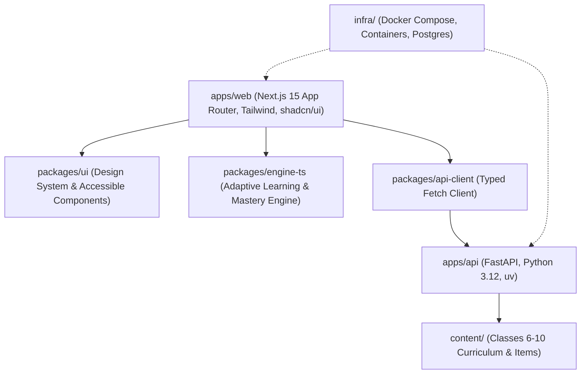

# BodhAI Architecture & System Design

BodhAI is an adaptive learning and diagnostic platform tailored for students in **Classes 6–10 in India** (web first).

---

## 1. System Overview & Tech Stack



### Core Technologies

- **Monorepo Engine**: [pnpm](https://pnpm.io/) workspaces + [Turborepo](https://turbo.build/repo)
- **Frontend**: [Next.js 15](https://nextjs.org/) App Router, React 19, TypeScript strict mode, Tailwind CSS, shadcn/ui
- **Backend**: [FastAPI](https://fastapi.tiangolo.com/), Python 3.12, [uv](https://docs.astral.sh/uv/) package manager
- **Shared Libraries**:
  - `@bodhai/ui`: Shared accessible component library conforming to WCAG 2.2 AA.
  - `@bodhai/engine-ts`: Shared TypeScript adaptive learning algorithms (Bayesian knowledge tracing, item difficulty calibrations).
  - `@bodhai/api-client`: End-to-end typed client for FastAPI backend.
  - `@bodhai/config`: Shared TypeScript compiler configurations and design baselines.
- **Content Repository**: `content/` hosting structured NCERT/State Board syllabus, competency trees, and diagnostic item banks.
- **Infrastructure**: `infra/` container definitions (Docker) and local orchestration (`docker-compose.yml`).

---

## 2. Directory Layout

```
.
├── .agent/                  # Antigravity/Agent rules and operational workflows
│   ├── rules/bodhai.md      # Core engineering guardrails and DoD
│   └── workflows/           # Step-by-step procedures (verify, new-feature)
├── .github/
│   └── workflows/ci.yml     # Automated PR verification with multi-layer caching
├── apps/
│   ├── api/                 # FastAPI service with Python 3.12, uv, Ruff, mypy
│   └── web/                 # Next.js App Router frontend with i18n and Tailwind
├── packages/
│   ├── config/              # Centralized tsconfig (base, next, react, node)
│   ├── ui/                  # Accessible UI component library
│   ├── engine-ts/           # Adaptive scoring and mastery calculation engine
│   └── api-client/          # Typed HTTP client communicating with apps/api
├── content/                 # Curriculum specs & diagnostic items for Classes 6-10
├── infra/                   # Docker Compose, Dockerfiles, and deployment configs
├── docs/                    # Architecture documents & ADRs
├── .editorconfig            # Editor consistency standards
├── .env.example             # Safe template for root environment variables
├── .gitleaks.toml           # Secret scanning rules and allowlists
├── .lintstagedrc.json       # Pre-commit staged linters
├── .nvmrc                   # Pinned Node.js version
├── .prettierrc              # Prettier formatting config
├── commitlint.config.mjs    # Conventional commits enforcement
├── eslint.config.mjs        # Flat ESLint configuration (zero warnings allowed)
├── package.json             # Root monorepo scripts (pnpm verify)
├── pnpm-workspace.yaml      # Monorepo workspace configuration
├── turbo.json               # Turborepo task pipeline
└── vitest.workspace.ts      # Multi-package Vitest workspace definition
```

---

## 3. Tooling & Quality Pipeline

Every check in BodhAI is strictly enforced with zero tolerance for warnings or loose typing:

| Tool                    | Scope                        | Policy                                                         |
| :---------------------- | :--------------------------- | :------------------------------------------------------------- |
| **ESLint**              | TS/JS (apps/web, packages/*) | Zero warnings allowed (`--max-warnings=0`), no `any` permitted |
| **Prettier**            | Entire repository            | Strictly checked via `prettier --check`                        |
| **Ruff**                | Python (apps/api)            | Strict PEP8, isort, linting and formatting                     |
| **mypy**                | Python (apps/api)            | `strict = true`, all functions and variables typed             |
| **Vitest**              | TS/JS unit tests             | Fast concurrent testing with `@testing-library/react`          |
| **pytest**              | Python unit tests            | Async testing via `pytest-asyncio` and `httpx`                 |
| **Playwright**          | Web E2E                      | Browser automation across Chromium, Firefox, WebKit            |
| **Husky & lint-staged** | Git hooks                    | Automatic pre-commit formatting & linting                      |
| **commitlint**          | Git commits                  | Enforces conventional commits (`feat:`, `fix:`, etc.)          |
| **gitleaks**            | Secret prevention            | Blocks accidental credential leaks                             |

---

## 4. Verification Gate: `pnpm verify`

The single command `pnpm verify` acts as the unified gate across all packages and services:

1. **Lint**: ESLint (0 warnings) + Python Ruff check + Prettier format check.
2. **Typecheck**: TypeScript `tsc --noEmit` across all workspaces + Python `mypy strict`.
3. **Unit Tests**: Vitest suite (web + ui + engine + api-client) + pytest (api).
4. **Build**: Turborepo build (`next build`, package compile, api validation).

Exits with a non-zero exit code if any check fails.
